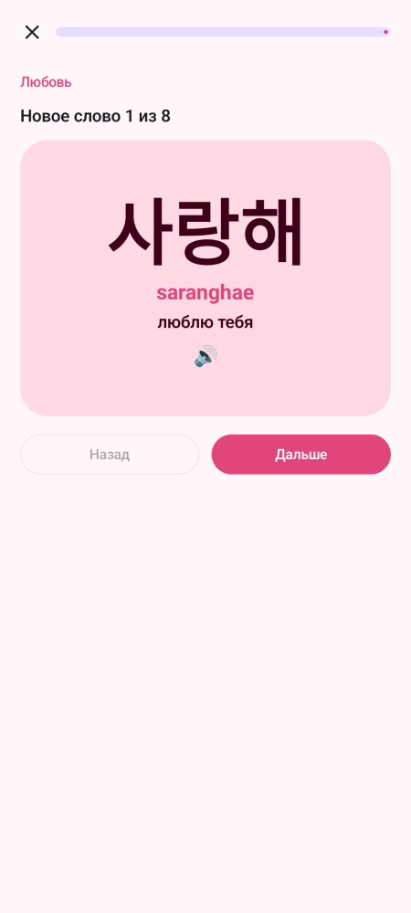
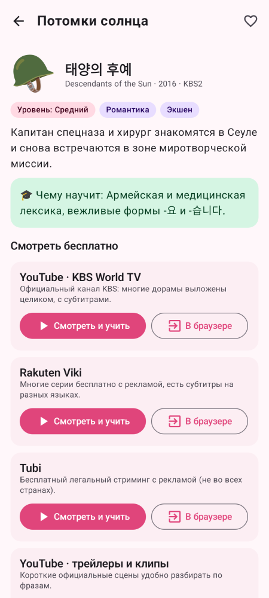

# Blo — дорамы и корейский 🇰🇷🎬

Android-приложение, где можно бесплатно смотреть корейские дорамы с официальных площадок и учить корейский — от первой буквы хангыля до живой речи из сериалов.

| Учёба | Урок | Дорамы | Дорама |
|---|---|---|---|
|  |  |  |  |

## Что внутри

**Курс из 6 уровней, 41 урок, ~330 слов и фраз**

| Уровень | Чему учит |
|---|---|
| 🌱 Новичок | хангыль: гласные, согласные, батчим, первые фразы |
| 🐣 Начальный (TOPIK 1) | знакомство, семья, числа, еда, глаголы, частицы |
| 🌿 Базовый+ (TOPIK 2) | прошедшее и будущее время, желания, отрицание, связки |
| 🌳 Средний (TOPIK 3–4) | условия, долженствование, -는데, предположения, опыт |
| 🏔️ Продвинутый (TOPIK 5–6) | -더라고요, -았/었더라면, косвенная речь, книжный стиль |
| 🎬 Про · язык дорам | банмаль, эмоции, любовь, обращения, сагык, сленг |

- В каждом уроке: карточки слов с озвучкой → грамматика с примерами → упражнения (перевод, обратный перевод, аудирование).
- **Тест уровня**: можно сразу перескочить уровни, которые уже знаешь.
- **Карточки с интервальным повторением** (SM-2): слова возвращаются ровно тогда, когда начинают забываться.
- **Таблица хангыля** с озвучкой и конструктором слогов.
- Опыт, стрик, дневная цель и звания: от «Стажёра» до «Мастера корейского».

**Дорамы**
- Каталог из 16 популярных дорам с уровнем сложности, жанрами и ключевыми фразами.
- Встроенный плеер: внизу открыта панель с фразами из дорамы, любую из них можно добавить в карточки, а услышанную фразу — записать самому.
- Можно открыть свою ссылку на видео.

## Легальность

Blo **не хранит и не распространяет видео**. Приложение открывает только официальные площадки, где дорамы доступны бесплатно (с рекламой):
[KBS World TV на YouTube](https://www.youtube.com/@KBSWorldTV), [Rakuten Viki](https://www.viki.com), [Tubi](https://tubitv.com).
Набор доступных серий зависит от страны.

## Установка

1. Скачай APK из раздела **Actions → Build APK → Artifacts** (`blo-apk`) или собери сам.
2. На телефоне разреши установку из неизвестных источников и открой APK.
3. Для озвучки нужен корейский голос в «Синтезе речи Google». Приложение подскажет, если его нет.

Нужен Android 8.0 или новее.

## Сборка

```bash
./gradlew assembleDebug        # app/build/outputs/apk/debug/app-debug.apk
./gradlew assembleRelease      # минифицированный APK (подписан debug-ключом)
./gradlew testDebugUnitTest    # тесты логики и рендер экранов (Paparazzi)
./gradlew recordPaparazziDebug # обновить скриншоты в app/src/test/snapshots
```

Стек: Kotlin, Jetpack Compose, Material 3, Navigation Compose, Android TextToSpeech, WebView. Прогресс хранится локально в SharedPreferences, без серверов и аккаунтов.

## Структура

```
app/src/main/java/com/blo/kdrama/
├── data/        курс (CourseData), дорамы (DramaData), хангыль, прогресс и SRS
├── tts/         озвучка корейского
└── ui/          навигация, тема и экраны
```
